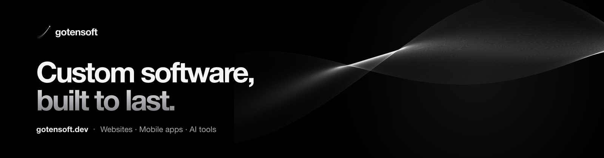

  

  A software studio that designs and builds custom websites, mobile apps and AI tools for growing businesses. 
  <a href="https://gotensoft.dev"><b>gotensoft.dev</b></a> · <a href="https://gotensoft.dev/es/">en español</a>

 

### What we build

- **Websites** — fast, bilingual sites that are easy to find on Google and easy to update
- **Mobile apps** — iOS and Android from one codebase, from the first screen to the store release
- **Business software** — back offices, dashboards and APIs on a solid PostgreSQL foundation
- **AI tools** — language models wired into real workflows, not demos

### How we work

Written requirements, weekly sprints and a live demo every week, from the first quote to the final delivery. Every project ships with error monitoring and daily backups.

### Track record

- Rebuilt a telecom app for iOS and Android: store ratings went from **1.2 to 4.0**
- Websites and apps used by **~800K people every day** for national consumer brands
- AI-generated ads and audience targeting that reached **1.7M+ households**

### Stack

  

<a href="https://gotensoft.dev/#contact">Start a project →</a>

