  

  Building web and mobile products end to end in TypeScript. 
  From the database schema to the App Store.

 

### 🧰 Stack

  

### 🛠️ What I work on

- **Mobile** — cross-platform apps with React Native and Expo, from first screen to store release
- **Web** — product dashboards and fast marketing sites with Next.js, Astro and React
- **Backend** — Node.js services and PostgreSQL with row-level security, realtime and storage
- **AI** — LLM features wired into real products, not demos
